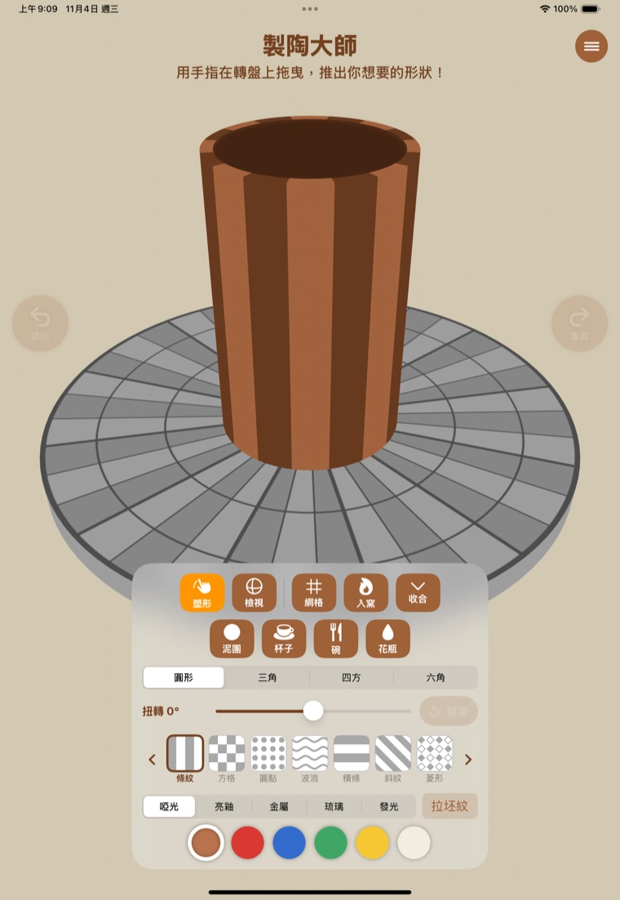
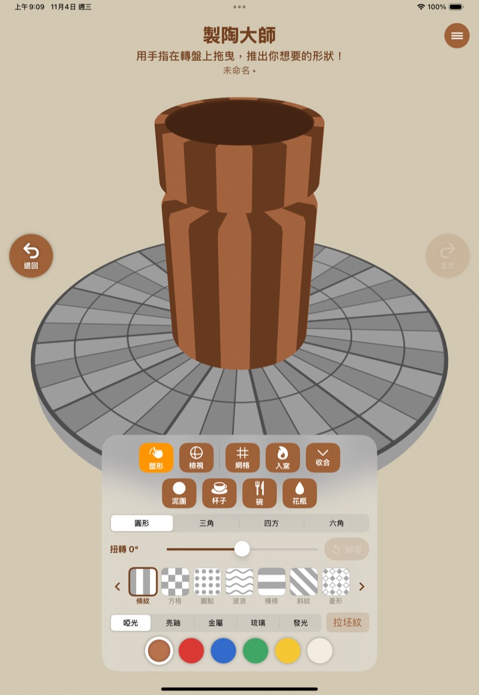
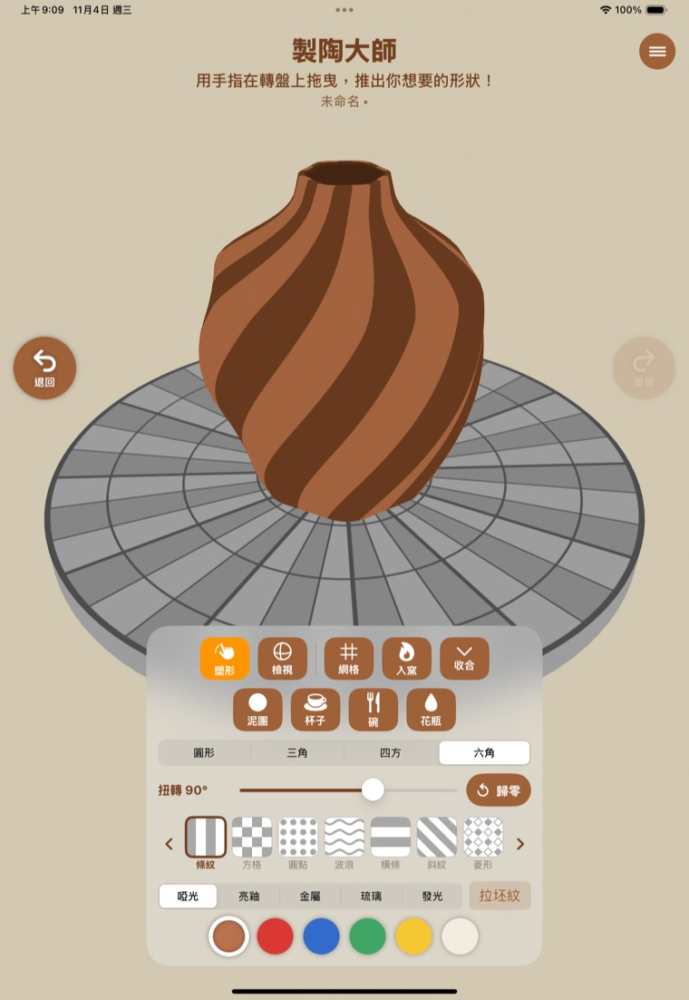
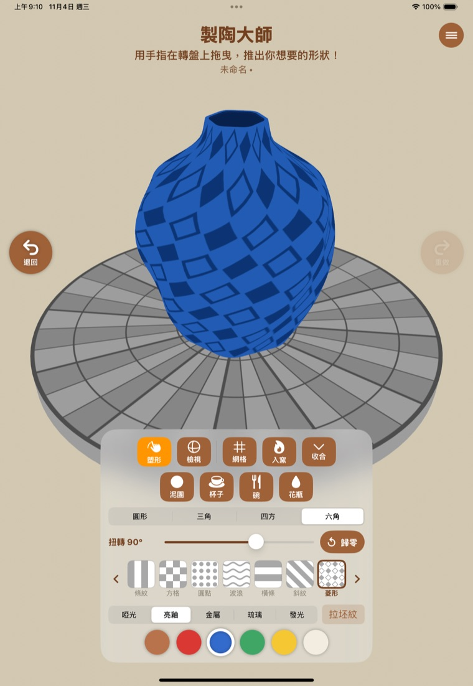
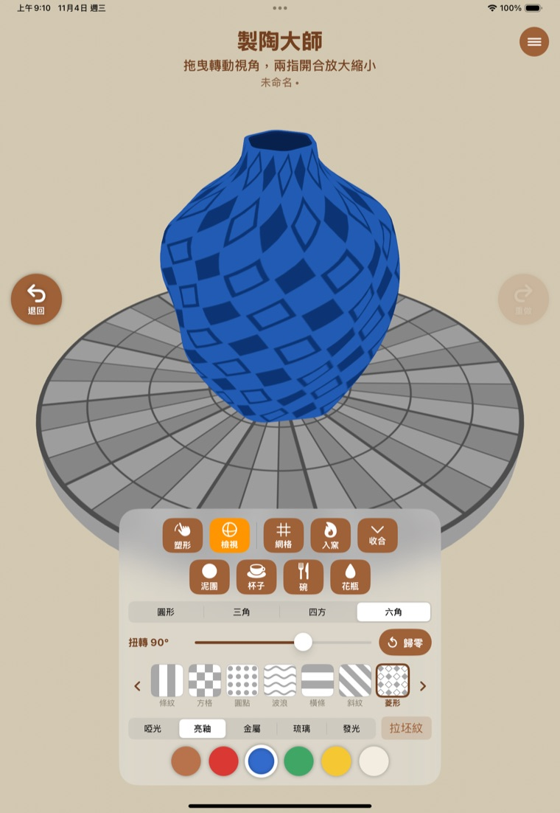
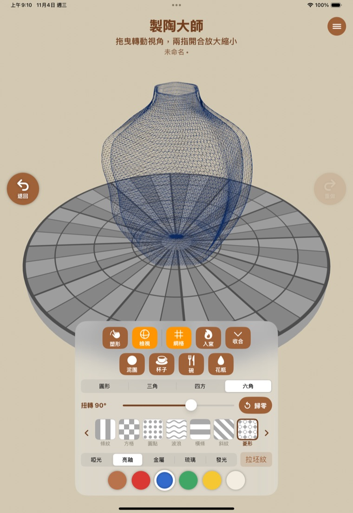
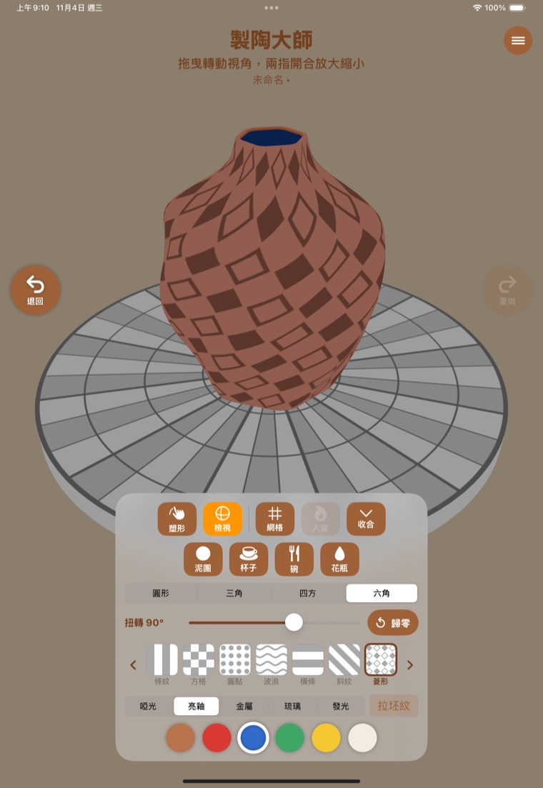
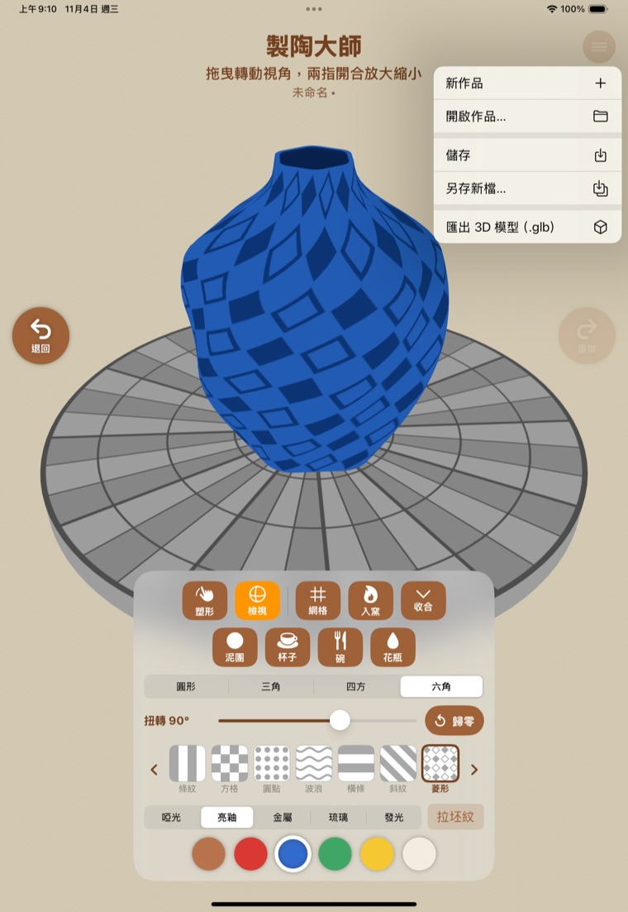

# 製陶大師 操作手冊（iPad 版）

用手指在轉盤上捏出一件陶器，上花紋、上釉、放進窯裡燒，最後存起來或匯出成 3D 模型。
這份手冊約 5 分鐘可以讀完，建議邊讀邊在 iPad 上試。

> 截圖取自 iPad 模擬器。真機上的亮釉、金屬、琉璃會有真實的反光和透明感，比截圖更漂亮。

---

## 1. 認識畫面

| 位置 | 功能 |
|---|---|
| 上方 | 標題與提示文字，提示會隨目前的模式改變 |
| 右上角 ☰ | 檔案選單：新作品、開啟、儲存、另存新檔、匯出 3D 模型 |
| 左、右兩側 | 「退回」和「重做」兩顆大按鈕 |
| 中間 | 轉盤和你的陶器 |
| 下方面板 | 所有工具：模式、形狀、扭轉、花紋、質感、釉色 |

按面板上的「收合」可以把面板縮小，讓陶器占更大的畫面；再按「展開」就回來。

---

## 2. 捏出形狀（塑形模式）

面板左上角的「塑形」亮橘色時，就是塑形模式。

- **用手指在陶器旁邊往內拖**，陶壁會跟著手指走，變窄；往外拖就變寬。
- 手指沿著陶器的高度上下移動，就能捏出一道道曲線。
- 剛按下去、還沒移動時形狀不會變，不用怕手滑。
- 如果提示說「從上面看不能塑形」，是因為視角太高，到「檢視」模式轉一下角度再回來。

**預設形狀**：「泥團、杯子、碗、花瓶」四顆按鈕可以一鍵換成基本的樣子，再從那裡開始修改。

**退回與重做**：捏壞了就按左邊的「退回」，最多可以退回 60 步。退太多了按右邊的「重做」。

---

## 3. 底面形狀與扭轉

- **底面形狀**：圓形、三角、四方、六角四選一。多邊形的轉角是圓弧倒角，不會割手。
- **扭轉**：拖動滑桿，從底到口把陶器扭轉，左右各最多 360°。
  - 每格 15°，所以 30°、45°、90°、180° 都能剛好停在上面。
  - 按「歸零」回到不扭轉。
  - 上圖是六角形的花瓶扭轉 90°，條紋會跟著扭。

---

## 4. 花紋

面板中間那一排小圖就是花紋：條紋、方格、圓點、波浪、橫條、斜紋、菱形、鋸齒、魚鱗、愛心、星星、花朵、回紋、圓圈、格紋、葉子，共 16 種，最後一個是「照片」。

- 用左右兩端的 **‹ ›** 翻頁，在觸控螢幕上也可以直接左右滑。
- 點一下就套用，選到的會有咖啡色框。

### 用自己的照片當花紋

1. 在花紋列翻到最後，選「照片」。
2. 按「選擇照片」，從相簿挑一張（想換就按「換一張照片」）。
3. 用「左右」「上下」兩條滑桿決定照片在陶器上重複幾張，按「自動」會挑一組讓照片不變形的張數。

照片會和作品一起存進 .pottery 檔，不會上傳到任何地方。

---

## 5. 質感與釉色

**質感**（面板下方第一排）：

| 質感 | 看起來 |
|---|---|
| 啞光 | 沒上釉的素燒，不反光 |
| 亮釉 | 光滑、會反光 |
| 金屬 | 像金屬一樣的光澤 |
| 琉璃 | 半透明的玻璃感 |
| 發光 | 自己會發光 |

**釉色**（最下面一排）：陶土、紅、藍、綠、黃、白。釉色會和花紋疊在一起。

**拉坯紋**：右邊的「拉坯紋」按鈕。打開後，陶器表面會出現像手拉出來的細紋，內外都有。
- 每次**重新打開**，紋路都會換一種：有的像一圈圈的細線，有的帶螺旋，有的像細砂或刷痕。喜歡哪一種就留著，不要再按。
- 關掉就是完全光滑的表面。

---

## 6. 檢視模式：轉轉看

點「檢視」，轉盤會停下來，這樣比較好看細節。

- **單指拖曳**：轉動視角，可以從上面、側面、下面看。
- **兩指開合**：放大、縮小。
- 這個模式不會改變形狀，放心滑。

**網格**：按「網格」可以看到陶器的線框，再按一次關掉。

---

## 7. 入窯燒製

做好之後按「入窯」。

- 陶器會慢慢燒紅，約 6 秒，期間轉盤會轉動。
- 燒好後，如果質感是啞光，會自動換成「亮釉」，有上過釉的感覺；你選的是別的質感就不會動。
- 燒的時候「入窯」按鈕會暫時按不了。

---

## 8. 存檔、開啟、匯出

點右上角的 ☰：

| 功能 | 說明 |
|---|---|
| 新作品 | 換一塊新泥團。如果目前的作品還沒存，會先問你要不要存 |
| 開啟作品… | 從「檔案」App 選一個 `.pottery` 檔 |
| 儲存 | 存到目前的檔案；第一次會問你存在哪裡、取什麼名字 |
| 另存新檔… | 換個名字存成另一份 |
| 匯出 3D 模型（.glb） | 給 Blender 等 3D 軟體用，不能再開回製陶大師 |

幾個要知道的事：

- 標題下面會顯示檔名。名字後面有「•」，代表有改動還沒存。
- **不用怕忘記存**：App 每隔一會兒會自動暫存。如果不小心關掉或被系統收掉，下次打開會問「要接著做上次的陶器嗎？」，選「接續」就回來了。
- 存檔時預設的名字是「陶器 日期」，同名的檔案會問你要不要覆蓋。
- `.pottery` 是製陶大師自己的存檔，連拉坯紋和照片都會保留，重新開啟長得一樣；`.glb` 只是給別的軟體看的 3D 模型。

---

## 9. 快速練習：做一個花瓶

1. 按「花瓶」，再用手指把瓶頸捏得更細。
2. 底面形狀選「六角」，把扭轉拉到 90°。
3. 花紋選「菱形」，釉色選藍色，質感選「亮釉」，打開「拉坯紋」。
4. 切到「檢視」轉一圈，滿意了按「入窯」。
5. ☰ → 儲存，取個名字。

## 10. 常見問題

| 問題 | 怎麼辦 |
|---|---|
| 捏壞了 | 按「退回」 |
| 手指拖了沒反應 | 看提示，可能是視角太高，到「檢視」轉個角度；也可能在「檢視」模式，要切回「塑形」 |
| 照片看不到 | 花紋要選最後一個「照片」，並且選過照片 |
| 找不到存的檔案 | 到「檔案」App 找你存的位置 |
| 面板擋住陶器 | 按「收合」 |
